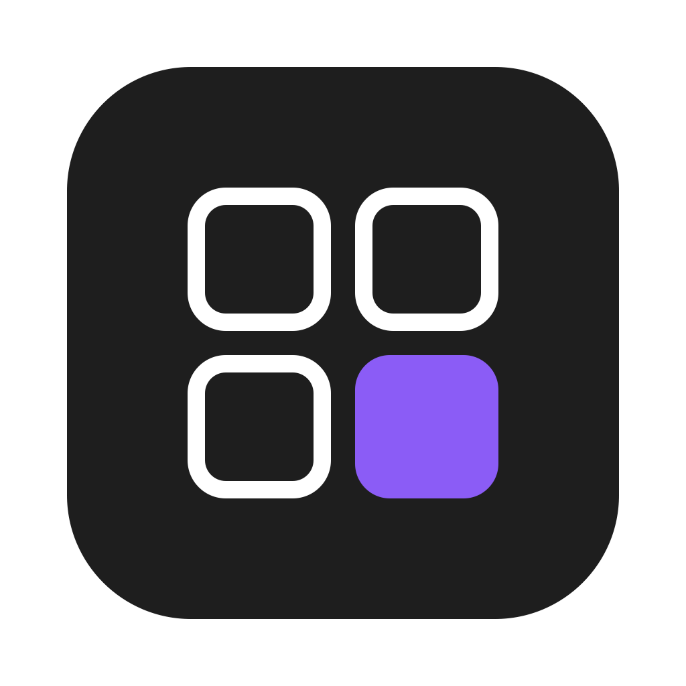

<p align="center"></p>

# iCONIQ

[](https://openmacapps.com/apps/iconiq/) [](https://github.com/starbudweiser/iCONIQ/releases/latest) [](LICENSE)

A personal icon library for macOS, inspired by IconJar.

🇬🇧 English · 🇫🇷 [Français](#français)

## About

**iCONIQ** is a personal icon library for macOS, inspired by IconJar (no affiliation with its authors). Import your IconJar libraries, browse icon portals from inside the app and capture icons straight into your own database, and receive icons created in MiCONE automatically.

Made by Starbudweiser & Claude Code (Anthropic). MIT License, © 2026 Starbudweiser. Provided as is, without warranty of any kind.

## Features

- Import IconJar libraries (`.ijlibrary`) and jars (`.iconjar`), icon folders and SVG / PNG / ICNS files.
- Built-in browser for icon portals whose addresses you enter yourself: search, navigation, detection of the icons on a page, click-to-capture mode, direct import of downloads (images and ZIP).
- Live link with MiCONE: every icon exported there lands in the "MiCONE" collection (a landing point: move it elsewhere and it leaves the folder) and is updated in place, wherever it was filed, when exported again.
- Search by name and tags, favorites, recents, collections and groups, copy as SVG / image, drag out to any app, export to PNG.
- Automatic updates (GitHub releases, Developer ID signature check). English, French, Spanish, Italian.

## Install

**[Download the latest notarized release](https://github.com/starbudweiser/iCONIQ/releases/latest)**, unzip it and move **iCONIQ.app** to your Applications folder. Requires **macOS 14 Sonoma** or later.

## Build

```bash
swift test          # core (database, importers, MiCONE drop box) and texts in the 4 languages
./build_app.sh      # builds, signs, installs in ~/Applications/Applications Personnelles
./release.sh 1.0.1  # tests, build, notarization, GitHub release
```

## Languages

English, French, Spanish and Italian. The app follows your Mac's preferred language automatically (English if it is none of these four).

## Support

Bug reports and suggestions: [GitHub Issues](https://github.com/starbudweiser/iCONIQ/issues).

## License

Released under the **MIT License**, © 2026 Starbudweiser. See [LICENSE](LICENSE).

---

## Français

Bibliothèque d'icônes personnelle pour macOS, inspirée d'IconJar (sans lien avec ses auteurs).

### Utilisation

- **Import** : bouton IMPORTER ou glisser-déposer d'une bibliothèque IconJar, d'un dossier ou de fichiers.
- **Portails** : `+` dans la section Portails, adresse du site, modèle de recherche facultatif (`{q}` = mot cherché). DÉTECTER liste les icônes de la page ; le viseur active le mode capture (un clic = un ajout).
- **MiCONE** : rien à régler, voir `Réglages › Lien avec MiCONE`.
- Données : `~/Library/Application Support/iCONIQ/` (`ICONIQ_DATA_DIR` pour les essais).

### Développement

```bash
swift test          # cœur (base, importeurs, boîte MiCONE) et textes des 4 langues
./build_app.sh      # compile, signe, installe dans ~/Applications/Applications Personnelles
./release.sh 1.0.1  # tests, build, notarisation, release GitHub
```

Installation : téléchargez la [dernière version notarisée](https://github.com/starbudweiser/iCONIQ/releases/latest), décompressez-la et placez **iCONIQ.app** dans Applications (macOS 14 Sonoma ou plus récent).

Interface en français, anglais, espagnol et italien, choisie d'après la langue du Mac (anglais sinon). Licence MIT, © 2026 Starbudweiser. Questions et bugs : [Issues GitHub](https://github.com/starbudweiser/iCONIQ/issues).
